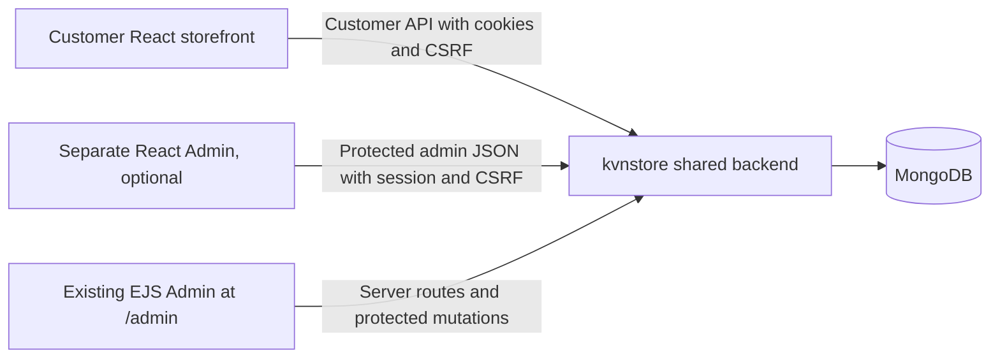

# Application boundaries

Inspected and reorganized on 2026-11-10 (Asia/Seoul).

## What was present

`kvnstore` was already the single Express/TypeScript backend. Its `src/schema`, `src/models`, controllers and middleware owned MongoDB, password hashing, customer JWT cookies, administrator sessions, role/status checks, input/upload validation, stock transactions, checkout, idempotency, reservations and fulfillment. Its EJS administration was already a distinct interface under `/admin`: `src/views/{home,login,products,orders,users}.ejs` with assets in `src/public`. Administrator collection routes negotiated HTML or JSON using `Accept`.

`kvnstore-react` contained the active customer React app and a second React admin UI mixed into its route tree, layout and customer provider. Older inactive React screens/services also remain in the tree; they are HTTP clients, not another backend. No duplicate runtime Express app, MongoDB model layer, database connection or private server environment was found in the frontend. The integration script did start the real sibling backend and an isolated MongoDB fixture; that test infrastructure now belongs to `kvnstore`.

## Result

| Responsibility                                                                        | Location                                                                                                            |
| ------------------------------------------------------------------------------------- | ------------------------------------------------------------------------------------------------------------------- |
| API, database, authentication, authorization, validation and business rules           | `kvnstore/src`                                                                                                      |
| Existing primary Admin interface                                                      | `kvnstore/src/views`, `src/public`, `/admin` routes; preserved in place                                             |
| Customer UI                                                                           | `kvnstore-react/src/app/App.tsx`, `src/app/storefront`                                                              |
| Preserved optional React Admin                                                        | `kvnstore-react/src/admin`; independent entry selection, layout, provider, development server and production bundle |
| Browser-only request client, response contracts, display components and form feedback | `kvnstore-react/src/shared`                                                                                         |
| Public URLs                                                                           | `kvnstore-react/src/lib/config.ts`, public `REACT_APP_*` environment values                                         |
| Isolated MongoDB/server integration harness                                           | `kvnstore/scripts/verify-frontend-integration.cjs`; frontend script is only a process launcher                      |

The customer app never imports React admin screens or makes admin session checks. Administration never initializes the customer provider or cart. The default storefront Administration link opens React admin at `http://localhost:3002/administration`. Older `/administration/*` storefront links point to the corresponding separate React page. Set `REACT_APP_ADMIN_URL=http://localhost:4003/admin` if EJS should be the external destination instead. Both admin interfaces remain available. A separate interface does not require another repository.

`scripts/interface.cjs` selects one application at build time. `yarn build` writes the storefront to `build`, and `yarn build:admin` writes Admin to `build-admin`. Both deployable builds omit source maps. `yarn verify:boundaries` uses temporary builds with source maps to check for accidental inclusion of the other UI or server dependencies, then removes those builds.

## Authentication and configuration

Both browser apps use `REACT_APP_API_URL` and the same fetch client with `credentials: include`. Customers use the backend's HttpOnly `accessToken`; Admin uses its separate HttpOnly `connect.sid` session. Customer login does not confer administrator access. EJS uses the same admin session and protected routes as React Admin. Login rotates the admin session and CSRF token; clients discard the old CSRF cache. No access token is stored in browser storage.

Every protected admin read and mutation runs `verifyAdmin` on the backend. It reloads the account and requires an active administrator. HTML unauthenticated navigation redirects to `/admin/login`; JSON calls and mutations fail closed. Customer order ownership, cart limits, stock, totals and fulfillment transitions remain server-enforced. React guards, input limits and displayed total estimates are navigation/form feedback only.

EJS is served from the backend origin and needs no CORS permission. React origins must appear exactly in the backend's `FRONTEND_ORIGINS`; local defaults and `.env.example` include `http://localhost:3000` and `http://localhost:3002`. The existing local explicit list was extended with only the Admin origin, preserving all previous origins and every secret setting. Other installations must configure their actual origins. CORS allows credentials, Content-Type, X-CSRF-Token, Idempotency-Key and the required methods. CORS does not grant admin permissions.

Use the same hostname consistently in local URLs; `localhost` and `127.0.0.1` are different cookie sites/origins. Production needs HTTPS, exact allowlisted origins, secure cookies and the correct reverse proxy setting. Cross-site frontends require `COOKIE_SAME_SITE=none` with secure cookies and remain subject to browser third-party-cookie restrictions. Same-site hosting is simpler.

Only public URLs and the nonproduction demo flag belong in frontend environment variables. `MONGO_URL`, `SESSION_SECRET`, `SECRET_TOKEN`, bootstrap credentials and payment-provider secrets remain exclusively in `kvnstore`. CRA embeds `REACT_APP_*` at build time, so rebuild after changing public production configuration. Both production interfaces need a hosting fallback to their own `index.html` for client routes.

## Run and verify

See the repository READMEs for dependency/database setup. From `kvnstore`, run `npm run start:dev` for the shared API and EJS Admin at `http://localhost:4003/admin/login`. From `kvnstore-react`, run `yarn start` for customers at `http://localhost:3000`. Optionally run `yarn start:admin` in another terminal for React Admin at `http://localhost:3002/administration`. Set each application's public URLs and backend allowlist as described above.

Run `npm test` in `kvnstore`. Run `yarn typecheck`, `yarn lint`, `CI=true yarn test --watchAll=false --runInBand`, both production builds, `yarn verify:boundaries` and `yarn verify:integration` in `kvnstore-react`. The latter launches backend-owned test infrastructure and exercises actual frontend request code against a fresh database, including EJS compatibility, admin denial/access, customer authentication, products, cart, checkout and demo fulfillment. No application `.env` or existing database is used.

For manual checks, `yarn verify:integration --browser` starts the isolated backend on `localhost:4003` and prints disposable account credentials, image fixtures and frontend commands. Start the customer app on `localhost:3000` and optional React Admin on `localhost:3002`, both pointed to that backend. EJS remains at `http://localhost:4003/admin/login`. Stop all test terminals with Ctrl-C; the backend cleans up its database and images.
